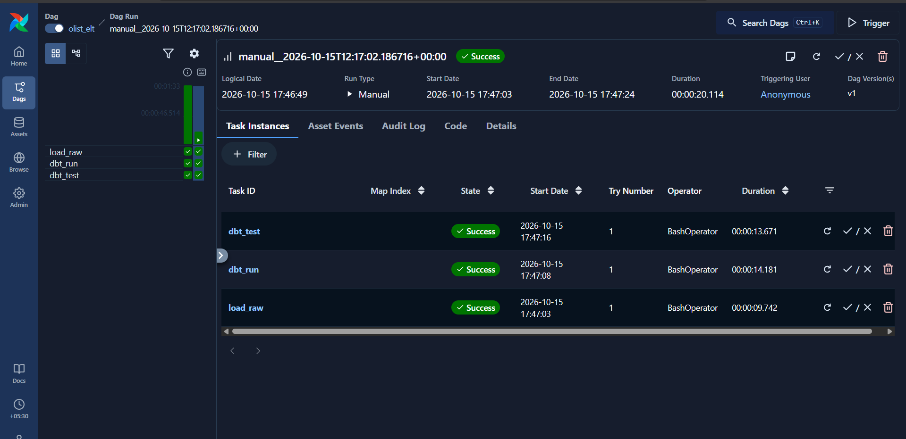
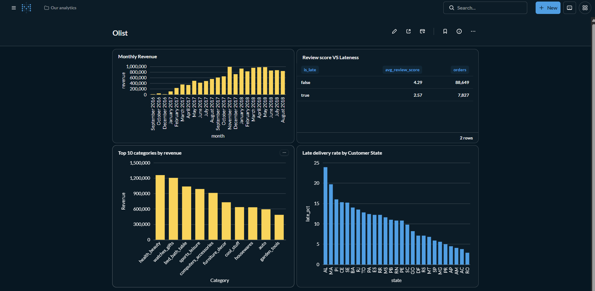
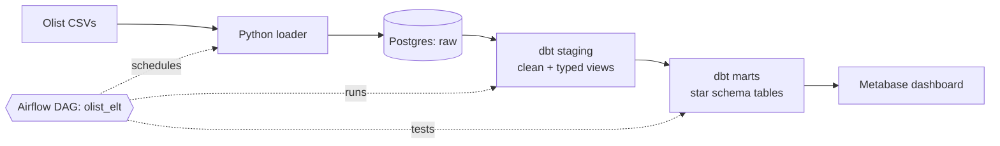

# Olist E-Commerce ELT Pipeline

An end-to-end batch data pipeline for the [Olist Brazilian E-Commerce dataset](https://www.kaggle.com/datasets/olistbr/brazilian-ecommerce) (~100k orders, 2016-2018). Raw CSVs are loaded into PostgreSQL, transformed into a star schema with dbt, orchestrated daily by Airflow, and visualised in Metabase. Everything runs locally in Docker.




## Architecture



The Airflow DAG `olist_elt` runs daily: `load_raw` -> `dbt_run` -> `dbt_test`.

## Tech stack

| Layer | Tool |
|---|---|
| Orchestration | Apache Airflow 3.2 |
| Transformation and testing | dbt (dbt-postgres) |
| Warehouse | PostgreSQL 16 |
| Ingestion | Python (psycopg2, `COPY`) |
| BI | Metabase |
| Infrastructure | Docker Compose |

## Data model

Three layers, each in its own Postgres schema:

- **`raw`**: exact copy of the source CSVs, every column stored as text.
- **`staging`**: one dbt view per raw table; renames columns and casts types only.
- **`marts`**: star schema built as tables.

```
dim_customers --+
dim_date -------+-- fct_orders -- fct_order_items --+-- dim_products
                |                                   +-- dim_sellers
```

- `fct_orders`: one row per order, with item, payment and review aggregates plus delivery metrics (`delivery_days`, `delivery_delay_days`, `is_late`).
- `fct_order_items`: one row per order item.
- `dim_customers`, `dim_products` (with English category names), `dim_sellers`, `dim_date` (generated in SQL).

## Data quality

dbt tests run on every pipeline run: `unique` and `not_null` on keys, `relationships` (foreign keys between facts and dimensions), and `accepted_values` on order status and review score.

## Design decisions

- **Raw layer stays untouched.** Loading everything as text keeps the raw layer a faithful copy of the source, so cleaning and casting logic lives in one place (dbt) and is testable.
- **Aggregate before joining in `fct_orders`.** Items, payments and reviews are aggregated to order level before joining, which avoids row fan-out and double-counted revenue.
- **Handled source-data quirks.** The translation CSV has a byte-order mark in its header (handled with `utf-8-sig`), `review_id` is not unique in the source (so it is deliberately not tested as unique), and some product categories lack English translations (fallback to the original name).
- **dbt runs in its own virtualenv inside the Airflow image**, avoiding dependency conflicts with Airflow's pinned packages.
- **Environment-driven connections.** The same code runs on a laptop (`localhost:5433`) and inside Docker (`warehouse:5432`) via `WAREHOUSE_HOST` / `WAREHOUSE_PORT`.

## Example findings

- Orders delivered after the estimated date average a review score of about **2.6**, versus about **4.3** for on-time orders.
- About **8%** of delivered orders (7,827 of 96,476) arrived late.

## Run it

Prerequisites: Docker Desktop.

1. Download the Olist dataset from Kaggle and place the 9 CSV files in `data/raw/`.
2. Start everything:
   ```powershell
   docker compose up -d --build
   ```
3. Open Airflow at http://localhost:8080, unpause `olist_elt` and click **Trigger**.
4. Open Metabase at http://localhost:3000 and add a PostgreSQL connection (host `warehouse`, port `5432`, database `olist`, user `de_user`, password `de_pass`).

Optional local development (outside Docker): create a Python 3.11 virtualenv, `pip install -r requirements.txt dbt-postgres`, run `python ingestion/load_raw.py`, then `dbt run` and `dbt test` from `olist_dbt/`.

## Project structure

```
.
├── docker-compose.yml     # warehouse, Airflow, Metabase
├── airflow/Dockerfile     # Airflow image with dbt in a separate venv
├── dags/olist_elt_dag.py  # load_raw >> dbt_run >> dbt_test
├── ingestion/load_raw.py  # CSV -> Postgres raw schema
├── olist_dbt/             # dbt project (staging + marts + tests)
├── sql/init.sql           # creates raw / staging / marts schemas
└── data/raw/              # source CSVs (not committed)
```

## Limitations and next steps

- The loader does a full refresh each run; true incremental loading would need a changing source.
- Airflow runs in standalone mode with authentication disabled and credentials are hardcoded: acceptable for local development only. A production setup would split Airflow services, use a secrets manager, and add alerting.
- Possible extensions: CI with GitHub Actions (`dbt build` on pull requests), dbt documentation site, cloud warehouse deployment.
